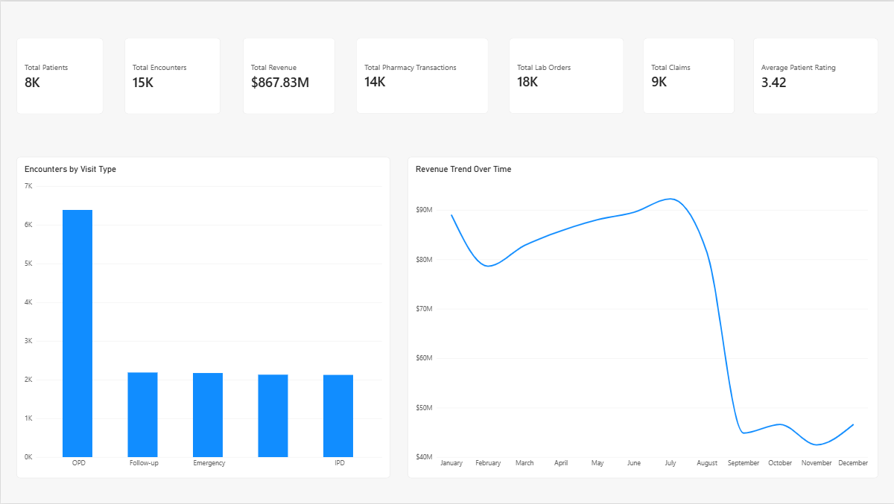
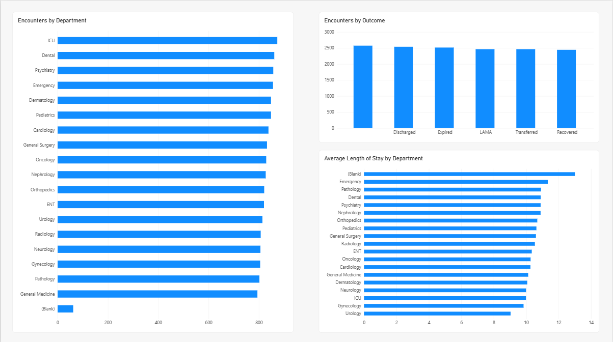
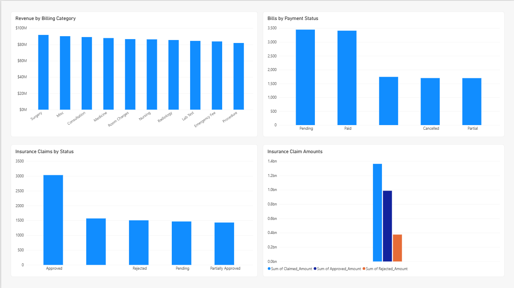
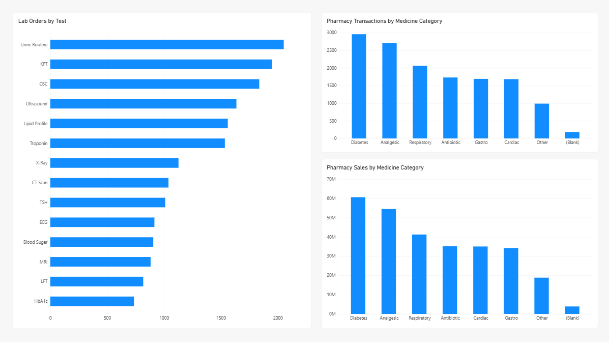
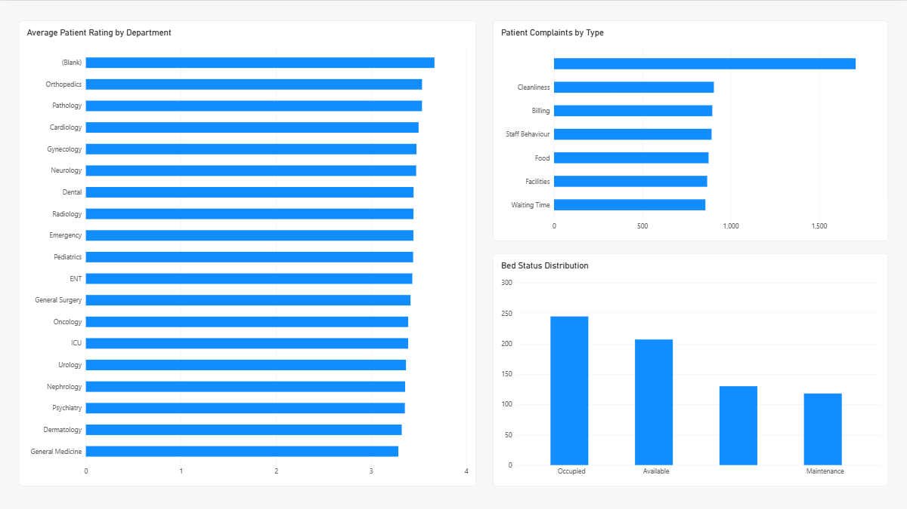

# Hospital Management Analytics Dashboard

A data analytics and business intelligence project built using **Python** and **Power BI** to analyze hospital operations, patient activity, finance, pharmacy, laboratory services, insurance claims, and patient feedback.

## Project Overview

The project covers the complete workflow from data cleaning and validation to relational data modeling, DAX-based KPI creation, and dashboard development.

### Key areas covered

- Patient and encounter analysis
- Department performance
- Hospital revenue and billing
- Insurance claims
- Pharmacy transactions and sales
- Laboratory orders
- Bed status and hospital operations
- Patient ratings and complaints

## Tools & Technologies

- **Python** — data cleaning and validation using Pandas
- **Jupyter Notebook** — data preparation and analysis workflow
- **Power BI Desktop** — data modeling, DAX measures, and dashboard development
- **DAX** — KPI calculations and analytical measures

## Data Model

The Power BI model uses **Encounters** as the central transactional table.

```text
Patients ────────┐
Departments ─────┤
Staff ───────────┤
Beds ────────────┤
                 ↓
             Encounters
                 │
       ┌─────────┼──────────┬──────────┬───────────┐
       ↓         ↓          ↓          ↓           ↓
    Billing   Pharmacy   Lab Orders  Claims    Feedback
               │            │
            Medicines    Lab Tests
```

The model uses one-to-many relationships from the relevant dimension/master tables to their transactional tables, with single-direction filtering to avoid ambiguous filter paths.

## Power BI Dashboard

The report contains five pages:

1. **Hospital Overview** — headline KPIs, encounter distribution, and revenue trend
2. **Patients & Encounters** — departments, visit types, outcomes, and length of stay
3. **Finance & Insurance** — billing, revenue, payment status, and insurance claims
4. **Pharmacy & Laboratory** — pharmacy transactions, medicine categories, sales, and lab orders
5. **Patient Feedback & Operations** — ratings, complaints, and bed status

### Core KPIs

- Total Patients
- Total Encounters
- Total Revenue
- Total Pharmacy Transactions
- Total Lab Orders
- Total Claims
- Average Patient Rating
- Average Length of Stay

## Repository Structure

```text
hospital_management_project/
├── data/
│   ├── raw/
│   └── cleaned/
├── notebooks/
├── scripts/
├── powerbi/
│   └── hospital_management_project.pbix
├── reports/
│   ├── overview.png
│   ├── patients_encounters.png
│   ├── finance_insurance.png
│   ├── pharmacy_laboratory.png
│   └── feedback_operations.png
└── README.md
```

## Dashboard Preview

### Hospital Overview



### Patients & Encounters



### Finance & Insurance



### Pharmacy & Laboratory



### Patient Feedback & Operations



## Project Outcome

The final Power BI report provides a consolidated view of hospital performance across clinical activity, financial operations, pharmacy, laboratory services, insurance, and patient experience.

## How to Use

1. Open the `.pbix` file in **Power BI Desktop**.
2. Keep the cleaned CSV files in their expected project location so the report can refresh successfully.
3. Use the five report pages to explore the different analytical areas.

## Author

**Shubham Hire**

Built as a portfolio project demonstrating data cleaning, relational data modeling, DAX, and Power BI dashboard development.
